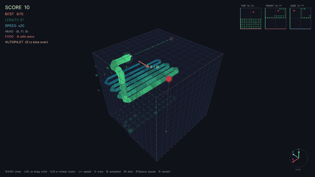
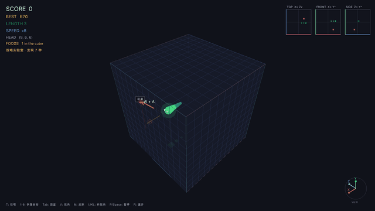
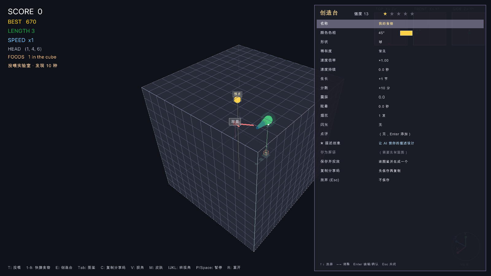
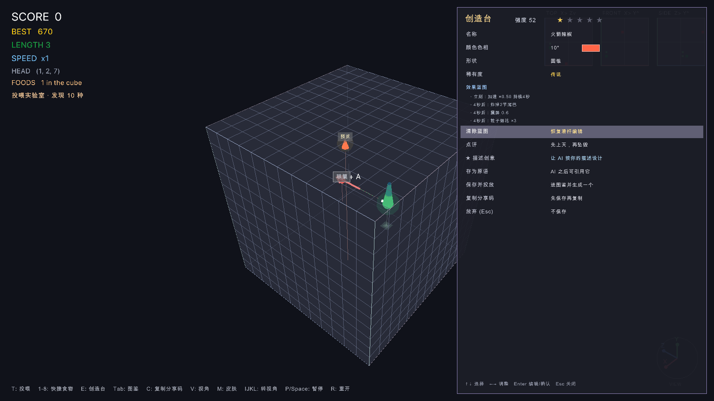
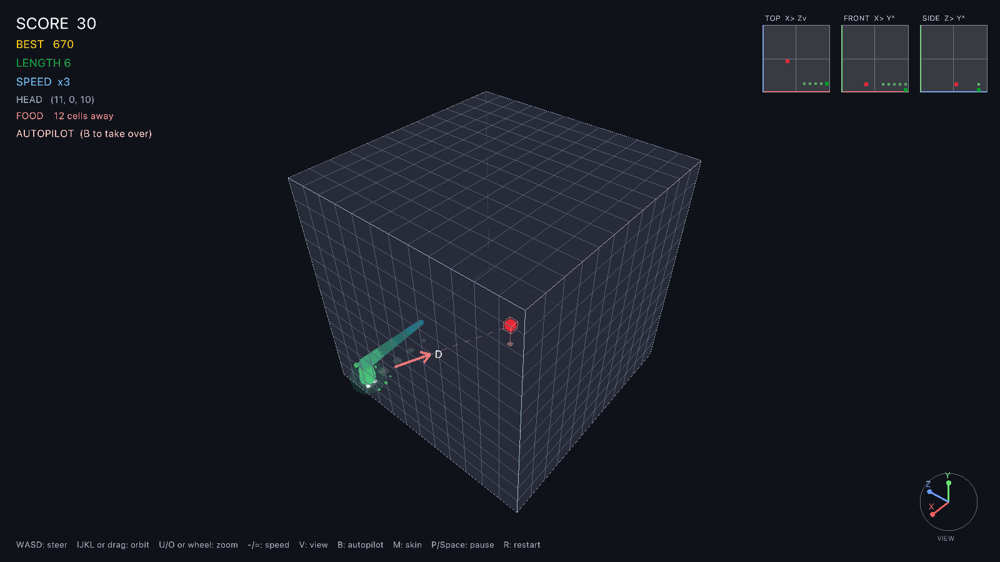
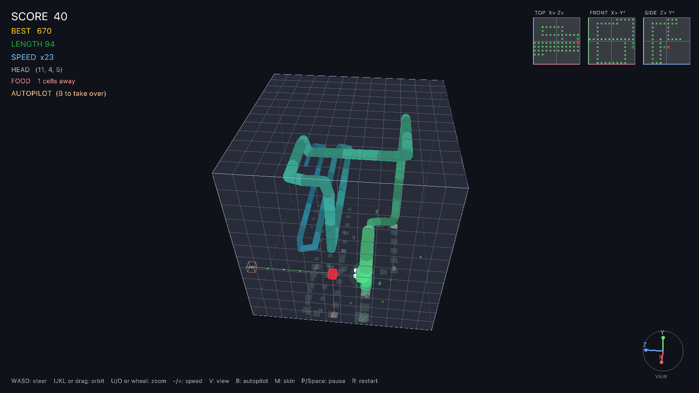
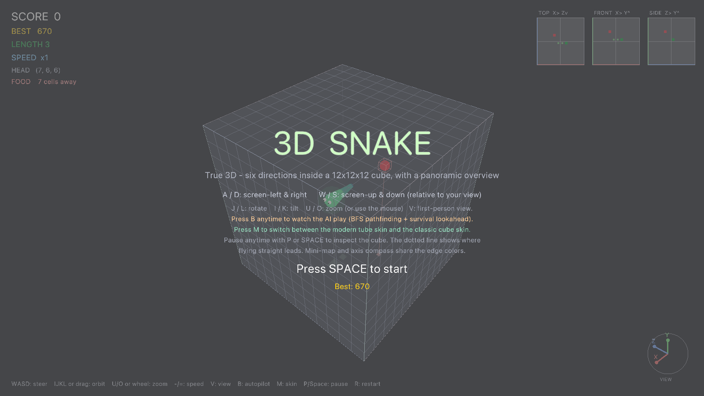

# 3D Snake (Odin + raylib)

A single-player, true-3D snake game written in **Odin** with **raylib**.
The snake flies through a 12×12×12 cubic lattice in **six directions** —
no gravity, no floor, pure 3D piloting.



*The built-in AI (press `B`) piloting a 90+ segment snake — BFS pathfinding
with survival lookahead, shown in the modern tube skin.*

## Feeding Lab (投喂实验室)

Press `F` on the title screen: the roles flip — **the AI flies the snake, you
invent the food**. Type any word (`T`) and the game deterministically
generates a food from it: color, shape, spin, rarity, and 1–3 effects
(speed burst, freeze, growth, body chop, score bonus/penalty, dizziness,
explosion…). The AI places it in the cube and hunts it down.



*A scripted tasting menu: apple + star → chili speed rage → grenade blows
the tail off → poop & poison mushroom (the snake will remember these).*

- **8 preset foods** on keys `1`–`8`: 苹果, 辣椒 (speed rage), 冰棍 (slow-mo),
  手榴弹 (blows off tail segments), 便便 (score penalty), 毒蘑菇 (dizziness),
  星星 (legendary bonus), 神秘蛋 (random effects every time)
- **Free-form foods** — every word becomes a unique, repeatable recipe;
  rare and legendary rolls get extra effects and a glowing aura
- **The snake learns** — hurt it twice with the same food name and it
  refuses to eat that food ever again (it rots away). Keep inventing!
- 蛇的"学习"按净收益判断（生长×2 + 分数/10 − 眩晕×1.5）——带副作用但大补的
  食物不会被拒食；连续吃亏两次才免疫，免疫时会弹提示
- **Food dex** (`Tab`) — every kind you've discovered, with its effect tags

### AI 配方（可选）

投喂一个新词时，游戏可以先让大语言模型为这个词现场"烹饪"一份配方：
颜色、形状、稀有度、一句幽默点评，以及加速/炸尾/眩晕等效果，全部贴合
食物的真实特性。配置方式（任何一个 OpenAI 兼容端点都可以，比如
Kimi、OpenAI 或本地 Ollama）：

```bash
export FEED_LLM_API_KEY=sk-...                     # 不设置 = 完全离线，纯本地生成
export FEED_LLM_BASE_URL=https://api.moonshot.cn/v1  # 默认值，可改成任意兼容端点
export FEED_LLM_MODEL=kimi-k2-0905-preview           # 默认值
```

- **无网络/无 key 也能玩** — 没有配置 key 时一切照旧（本地哈希生成）；
  请求失败、超时（12 秒）或 AI 输出解析失败时，也会自动保留本地配方
- **不卡游戏** — 请求在工作线程里通过 `curl` 发出，游戏循环照常运行；
  HUD 会显示 `AI 烹饪中: <词>`，完成后配方就地替换占位食物
- **同一时刻只烹饪一个词** — 烹饪期间再投喂新词将直接使用本地配方
- 词的来源会在图鉴中标注：`预设` / `本地` / `AI` / `分享`

### 分享码

每种食物都可以变成一串可移植的分享码（`SNAKE3D1.` 开头，base64url
编码的 JSON 配方）：

- 投喂后按 `C` — 复制最近一次投放的食物的分享码
- 图鉴（`Tab`）里用 `↑` / `↓` 选择，按 `C` 复制选中那一行
- 在投喂框（`T`）里 `Cmd+V` 粘贴别人的 `SNAKE3D1.…` 分享码并回车 —
  解码、校验、数值钳制后作为新食物投放（重名会自动加 `~2` 后缀）

### 创造台（按 `E`）

投喂模式下按 `E` 打开创造台：右侧设计面板 + 立方体里的实时预览样品，
游戏照常运行。`↑` `↓` 选字段，`←` `→` 调数值（按住连续调整），
`Enter` 编辑文本或触发按钮，`Esc` 关闭。

- **手动滑杆** — 名称、色相、形状、稀有度，以及速度倍率/持续、生长、
  分数、震屏、眩晕、烟花、闪光；面板顶部显示纯娱乐向的"强度值"和
  1–5 颗星
- **★ 描述创意** — 用自然语言描述想要的效果（比如"火箭辣椒"
  "会下蛋的母鸡"），AI 会直接产出整套设计：名称、颜色、稀有度、
  一句点评，外加一份可编排的**效果蓝图**。使用和 AI 配方相同的
  `FEED_LLM_*` 环境变量；未配置 key 时只能手动设计
- **效果蓝图** — 蓝图由 11 种原语节点组成：加速、生长、分数、震屏、
  眩晕、闪光、烟花，以及 **下蛋**（在场上生出新食物）、**金身**
  （无敌，撞墙咬身都不死）、**掉头反转**（头尾互换）、**得分倍率**；
  还能用 delay / repeat / chance 编排节奏。存在蓝图时滑杆自动隐藏，
  图鉴里的效果标签会带上 `[蓝图]` 标记
- **存为原语** — 把当前蓝图命名保存成自己的"原语"（写入 `macros.json`
  持久化）。之后 AI 设计时可以直接引用这些原语；导出分享码时会把引用到
  的原语自动打包，接收方导入即自动注册（不覆盖本地同名原语）
- **创作者昵称** — 第一次保存时会询问一次昵称并写入 `creator.txt`
  （环境变量 `SNAKE_CREATOR` 优先），之后导出的分享码都带这个落款
- **作品库** — 每次「保存并投放」都会把作品存进 `creations.json`（上限
  64 个），下次启动自动载回图鉴；图鉴里选中自创作品按 `X` 从作品库删除
  （场上已投放的不受影响），按 `Enter` 直接再投喂一份
- **⇧1-8 快捷投喂** — 不看图鉴也能快速复投：`⇧1` 是最近保存的作品，
  `⇧2` 次之，以此类推；HUD 底部会列出当前各键对应的作品名
- 图鉴（`Tab`）里选中一行按 `E`，可以**以此为基础改造**已有食物

| 手动设计 | AI 创意蓝图 |
| :---: | :---: |
|  |  |

## Features

- **True 3D movement** — six directions (±X, ±Y, ±Z) inside a 12³ cube
- **AI autopilot** (`B`) — watch the AI play: BFS shortest path to the food,
  plus a survival simulation that only commits to a meal when the head can
  still reach its own tail afterwards; falls back to tail-chasing to stay
  alive and auto-restarts after death. Take back control anytime with `B`
- **Two snake skins** (`M`) — a glossy modern tube body (tapered capsules,
  emerald→ocean gradient, specular glints, head aura, distance fog) or the
  classic cube look
- **Panoramic orbit camera** by default: the whole cube rotates around its
  center as one rigid object (keyboard `IJKL` or mouse drag), with an
  optional **first-person view** (press `V`)
- **Screen-relative steering** — in orbit view `A/D/W/S` always mean
  screen-left/right/up/down, no matter how the cube is rotated
- **Flight-path guide** — a dotted line ahead of the snake shows where flying
  straight leads, colored green → yellow → red by distance to the obstacle
- **Navigation aids** — tri-view minimap (top / front / side projections),
  a camera-linked axis compass, an on-screen guidance arrow with key hints,
  a dashed head→food tether line, and a live "cells away" readout
- **Speed control** — `-` slows down, `=` speeds up; eating also accelerates
- Pause anytime and keep orbiting the frozen cube to plan your route
- Smooth interpolated movement and 90° turn animations, particles,
  procedurally synthesized sound effects (no asset files),
  persistent best score

## Screenshots

| Modern tube skin | AI autopilot, 94 segments |
|---|---|
|  |  |



## Controls

| Input | Action |
|---|---|
| `A` / `D` or `←` / `→` | Steer screen-left / screen-right |
| `W` / `S` or `↑` / `↓` | Steer screen-up / screen-down |
| `B` | Toggle AI autopilot |
| `M` | Toggle modern / classic skin |
| `J` / `L` | Rotate the cube |
| `I` / `K` | Tilt the cube |
| `U` / `O` or mouse wheel | Zoom in / out |
| Mouse drag (left or right) | Orbit (alternative) |
| `V` | Toggle first-person / orbit camera |
| `-` / `=` | Slow down / speed up |
| `P` or `Space` | Pause / resume |
| `R` | Restart |
| `Space` / `Enter` | Start / play again |

### Feeding Lab only

| Input | Action |
|---|---|
| `T` | Open the feed box — type any word, Enter to cast it |
| `1` – `8` | Cast a preset food instantly |
| `⇧1` – `⇧8` | 快捷投喂作品库里的自创作品（最近保存的在前） |
| `E` | Open the 创造台 (Creator Workshop); with the dex open, remix the selected kind |
| `Tab` | Toggle the food dex (discovered kinds & effects) |
| `↑` / `↓` (in dex) | Select a row |
| `Enter` (in dex) | 投喂选中的食物（图鉴保持打开） |
| `X` (in dex) | 从作品库删除选中的自创作品 |
| `C` | Copy the share code (last cast, or the selected dex row) |
| `Cmd+V` (in feed box) | Paste a `SNAKE3D1.` share code to import |

### 创造台 (Creator Workshop) only

| Input | Action |
|---|---|
| `↑` / `↓` | Move the field cursor |
| `←` / `→` | Adjust the value (hold to auto-repeat) |
| `Enter` | Edit text / trigger the button |
| `Esc` | Cancel the current input, then close the workshop |

## Download

Grab the prebuilt binary from
[Releases](../../releases) (`snake3d-macos-arm64.zip`, macOS Apple Silicon).
The binary is self-contained (raylib statically linked, system fonts only).

> First launch: macOS Gatekeeper may block an unsigned download —
> right-click the app and choose **Open**, or run
> `xattr -d com.apple.quarantine snake3d`.

## Build from source

Requires the [Odin compiler](https://odin-lang.org/) (ships with `vendor:raylib`):

```bash
odin build . -out:snake3d -o:speed
./snake3d
```

Single file: `main.odin`, no other dependencies.
