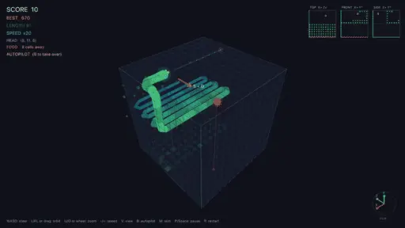
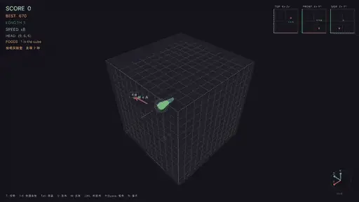

# 3D 贪食蛇（Odin + raylib）

> 语言：**简体中文** | [English](README_EN.md)

用 **Odin** + **raylib** 写的单人真·3D 贪食蛇。蛇在 12×12×12 的立方格子里
沿**六个方向**飞行——没有重力，没有地面，纯粹的 3D 驾驶。



*内置 AI（按 `B`）驾驶 90 多节的长蛇——BFS 寻路 + 生存预判，
图中为现代圆管皮肤。*

## 投喂实验室

在标题界面按 `F`，角色互换——**AI 开蛇，你来发明食物**。随便输入一个词
（按 `T`），游戏就会用它确定性地生成一种食物：颜色、形状、旋转、稀有度，
以及 1–3 种效果（暴走加速、冰冻减速、生长、炸尾、加分/扣分、眩晕、
爆炸……）。AI 把食物放进立方体并追猎它。



*一出剧本化的品尝菜单：苹果 + 星星 → 辣椒暴走 → 手榴弹炸尾 →
便便 & 毒蘑菇（蛇会记住这两样）。*

- **8 种预设食物**，数字键 `1`–`8`：苹果、辣椒（暴走）、冰棍（慢速）、
  手榴弹（炸掉尾巴）、便便（扣分）、毒蘑菇（眩晕）、星星（传说加分）、
  神秘蛋（每次效果随机）
- **自由造词** — 每个词都会变成独一无二、可复现的配方；稀有和传说
  档位附带额外效果和发光光环
- **蛇会学习** — 按净收益判断好坏（生长×2 + 分数/10 − 眩晕×1.5），
  带副作用但大补的食物不会被拒食；用同一种食物坑它两次，它就终身
  拒吃（食物会腐烂消失），免疫时会弹提示。继续发明新词吧！
- **食物图鉴**（`Tab`）— 你发现过的每一种食物及其效果标签

### AI 配方（可选）

投喂一个新词时，游戏可以先让大语言模型为这个词现场"烹饪"一份配方：
颜色、形状、稀有度、一句幽默点评，以及加速/炸尾/眩晕等效果，全部贴合
食物的真实特性。配置方式（任何一个 OpenAI 兼容端点都可以，比如
Kimi、OpenAI 或本地 Ollama）：

```bash
export FEED_LLM_API_KEY=sk-...                     # 不设置 = 完全离线，纯本地生成
export FEED_LLM_BASE_URL=https://api.moonshot.cn/v1  # 默认值，可改成任意兼容端点
export FEED_LLM_MODEL=kimi-k2-0905-preview           # 默认值
```

- **无网络/无 key 也能玩** — 没有配置 key 时一切照旧（本地哈希生成）；
  请求失败、超时（12 秒）或 AI 输出解析失败时，也会自动保留本地配方
- **不卡游戏** — 请求在工作线程里通过 `curl` 发出，游戏循环照常运行；
  HUD 会显示 `AI 烹饪中: <词>`，完成后配方就地替换占位食物
- **同一时刻只烹饪一个词** — 烹饪期间再投喂新词将直接使用本地配方
- 词的来源会在图鉴中标注：`预设` / `本地` / `AI` / `分享`

### 分享码

每种食物都可以变成一串可移植的分享码（`SNAKE3D1.` 开头，base64url
编码的 JSON 配方）：

- 投喂后按 `C` — 复制最近一次投放的食物的分享码
- 图鉴（`Tab`）里用 `↑` / `↓` 选择，按 `C` 复制选中那一行
- 在投喂框（`T`）里 `Cmd+V` 粘贴别人的 `SNAKE3D1.…` 分享码并回车 —
  解码、校验、数值钳制后作为新食物投放（重名会自动加 `~2` 后缀）

### 创造台（按 `E`）

投喂模式下按 `E` 打开创造台：右侧设计面板 + 立方体里的实时预览样品，
游戏照常运行。`↑` `↓` 选字段，`←` `→` 调数值（按住连续调整），
`Enter` 编辑文本或触发按钮，`Esc` 关闭。

- **手动滑杆** — 名称、色相、形状、稀有度，以及速度倍率/持续、生长、
  分数、震屏、眩晕、烟花、闪光；面板顶部显示纯娱乐向的"强度值"和
  1–5 颗星
- **★ 描述创意** — 用自然语言描述想要的效果（比如"火箭辣椒"
  "会下蛋的母鸡"），AI 会直接产出整套设计：名称、颜色、稀有度、
  一句点评，外加一份可编排的**效果蓝图**。使用和 AI 配方相同的
  `FEED_LLM_*` 环境变量；未配置 key 时只能手动设计
- **效果蓝图** — 蓝图由 11 种原语节点组成：加速、生长、分数、震屏、
  眩晕、闪光、烟花，以及 **下蛋**（在场上生出新食物）、**金身**
  （无敌，撞墙咬身都不死）、**掉头反转**（头尾互换）、**得分倍率**；
  还能用 delay / repeat / chance 编排节奏。存在蓝图时滑杆自动隐藏，
  图鉴里的效果标签会带上 `[蓝图]` 标记
- **存为原语** — 把当前蓝图命名保存成自己的"原语"（写入 `macros.json`
  持久化）。之后 AI 设计时可以直接引用这些原语；导出分享码时会把引用到
  的原语自动打包，接收方导入即自动注册（不覆盖本地同名原语）
- **创作者昵称** — 第一次保存时会询问一次昵称并写入 `creator.txt`
  （环境变量 `SNAKE_CREATOR` 优先），之后导出的分享码都带这个落款
- **作品库** — 每次「保存并投放」都会把作品存进 `creations.json`（上限
  64 个），下次启动自动载回图鉴；图鉴里选中自创作品按 `X` 从作品库删除
  （场上已投放的不受影响），按 `Enter` 直接再投喂一份
- **⇧1-8 快捷投喂** — 不看图鉴也能快速复投：`⇧1` 是最近保存的作品，
  `⇧2` 次之，以此类推；HUD 底部会列出当前各键对应的作品名
- 图鉴（`Tab`）里选中一行按 `E`，可以**以此为基础改造**已有食物

| 手动设计 | AI 创意蓝图 |
| :---: | :---: |
|  |  |

## 特色功能

- **真·3D 移动** — 12³ 立方体内六向飞行（±X、±Y、±Z）
- **AI 自动驾驶**（`B`）— 看 AI 自己玩：到食物的 BFS 最短路径 +
  生存模拟（只有模拟出吃完后蛇头仍能够到自己尾巴，才会真正下口）；
  找不到安全路线就追自己尾巴保命，死亡后自动重开。随时按 `B` 夺回控制
- **两套蛇身皮肤**（`M`）— 流光现代圆管（渐缩胶囊、祖母绿→深海渐变、
  高光、头部光环、距离雾）或经典方块
- **全景环绕相机**（默认）— 整个立方体绕中心刚体旋转（键盘 `IJKL`
  或鼠标拖拽），也可切换**第一人称视角**（按 `V`）
- **屏幕相对转向** — 环绕视角下 `A/D/W/S` 永远对应屏幕左/右/上/下，
  无论立方体转到什么角度
- **航迹引导** — 蛇头前方的虚线显示直飞的落点，按到障碍物的距离
  由绿→黄→红渐变
- **导航辅助** — 三视图小地图（顶/前/侧投影）、相机联动的轴向罗盘、
  带按键提示的屏幕指引箭头、蛇头→食物的虚线牵引线、实时"距离 N 格"读数
- **速度调节** — `-` 减速，`=` 加速；进食也会提速
- 随时暂停，继续环绕观察静止的立方体来规划路线
- 平滑插值移动与 90° 转向动画、粒子效果、程序化合成音效（无音频资源
  文件）、最高分持久化

## 截图

| 现代圆管皮肤 | AI 自动驾驶，94 节 |
|---|---|
|  |  |


## 操作

| 按键 | 作用 |
|---|---|
| `A` / `D` 或 `←` / `→` | 屏幕左 / 右转向 |
| `W` / `S` 或 `↑` / `↓` | 屏幕上 / 下转向 |
| `B` | AI 自动驾驶开关 |
| `M` | 现代 / 经典皮肤切换 |
| `J` / `L` | 旋转立方体 |
| `I` / `K` | 俯仰立方体 |
| `U` / `O` 或鼠标滚轮 | 拉近 / 拉远 |
| 鼠标拖拽（左键或右键） | 环绕视角（替代方式） |
| `V` | 第一人称 / 环绕视角切换 |
| `-` / `=` | 减速 / 加速 |
| `P` 或 `空格` | 暂停 / 继续 |
| `R` | 重开 |
| `空格` / `Enter` | 开始 / 再来一局 |

### 投喂实验室专用

| 按键 | 作用 |
|---|---|
| `T` | 打开投喂框——输入任意词，回车投放 |
| `1` – `8` | 立即投放预设食物 |
| `⇧1` – `⇧8` | 快捷投喂作品库里的自创作品（最近保存的在前） |
| `E` | 打开创造台；图鉴打开时按 `E` 以此为基础改造选中食物 |
| `Tab` | 食物图鉴开关（已发现的食物与效果） |
| `↑` / `↓`（图鉴内） | 选择一行 |
| `Enter`（图鉴内） | 投喂选中的食物（图鉴保持打开） |
| `X`（图鉴内） | 从作品库删除选中的自创作品 |
| `C` | 复制分享码（最近投放的，或图鉴中选中的那行） |
| `Cmd+V`（投喂框内） | 粘贴 `SNAKE3D1.` 分享码导入 |

### 创造台专用

| 按键 | 作用 |
|---|---|
| `↑` / `↓` | 移动字段光标 |
| `←` / `→` | 调整数值（按住连续调整） |
| `Enter` | 编辑文本 / 触发按钮 |
| `Esc` | 取消当前输入，再按关闭创造台 |

## 下载

从 [Releases](../../releases) 下载预编译二进制
（`snake3d-macos-arm64.zip`，macOS Apple Silicon）。二进制完全自包含
（raylib 静态链接，只用系统字体）。

> 首次运行：macOS Gatekeeper 可能拦截未签名的下载——右键点 App 选
> **打开**，或执行 `xattr -d com.apple.quarantine snake3d`。

## 从源码构建

需要 [Odin 编译器](https://odin-lang.org/)（自带 `vendor:raylib`）：

```bash
odin build . -out:snake3d -o:speed
./snake3d
```

单文件：`main.odin`，没有其他依赖。
