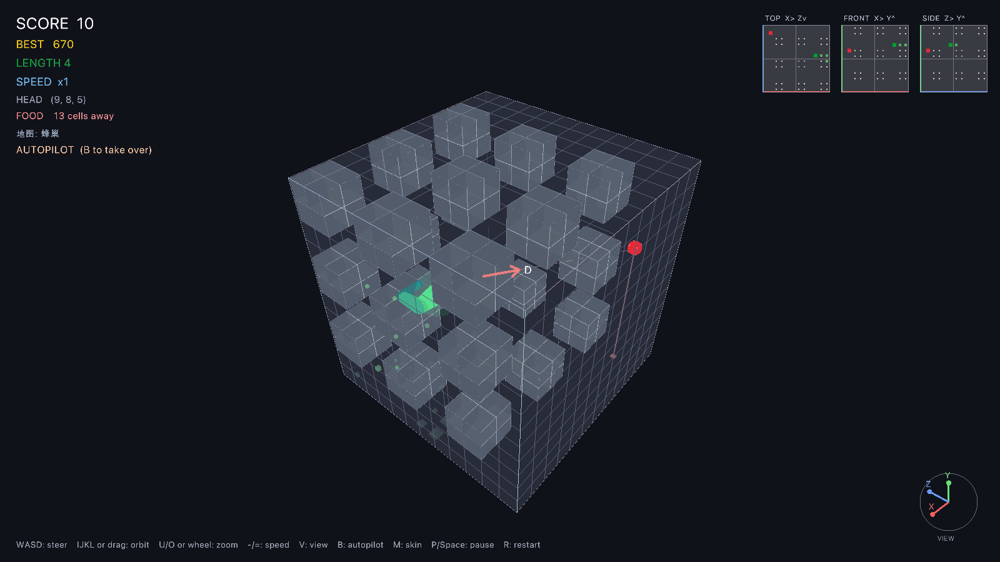
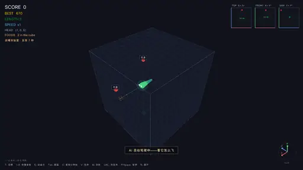
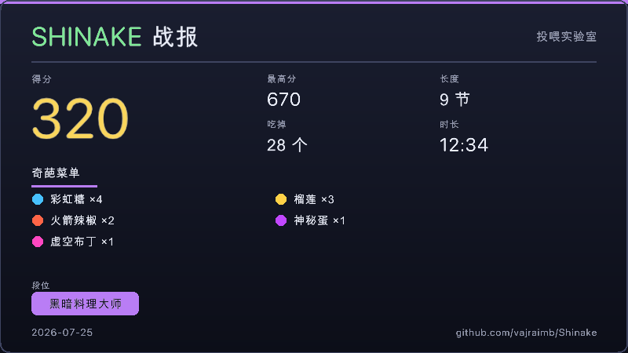

# 🐍 Shinake

> **食（shi）× Snake × Shine** —— AI 开蛇，你当造物主。
> 说一句话，造一道菜，看它吃出什么事儿。

[](../../releases)
[](LICENSE)
[](/)
[](https://odin-lang.org/)
[](../../stargazers)

**简体中文** | [English](README_EN.md)


*一出剧本化的品尝菜单：苹果 + 星星 → 辣椒暴走 → 手榴弹炸尾 →
便便 & 毒蘑菇（蛇会记住这两样，终身拒吃）。*

## 🎮 30 秒上手

1. 去 [Releases](../../releases) 下载 `Shinake-macos-arm64.zip`，解压
   （首次运行右键点 **打开**，或 `xattr -d com.apple.quarantine shinake`）
2. 标题界面按 `F` 进入**投喂实验室**
3. 按 `T`，输入任意词——比如"榴莲"——回车

然后看着 AI 蛇扑向你的杰作。按 `E` 打开**创造台**，按 `B` 看 AI 自己玩。

## ✨ 为什么你会上瘾

- 🔄 **角色互换** — 这次不是你开蛇。AI 负责飞，你负责发明黑暗料理：
  每个词都变成颜色、形状、稀有度、效果俱全的独特配方
- 🕹️ **原味硬核挑战** — 传统玩法完整保留：标题界面直接回车，亲自驾驶
  六向贪食蛇在 12³ 立方体里求生。说来简单，试试就知道有多硬核——
  撑不住了随时按 `B` 让 AI 救场
- 🗣️ **一句话造物** — 在创造台说"火箭辣椒""会下蛋的母鸡"，AI 连名字、
  颜色到"先暴走 4 秒再爆炸炸尾"的剧本都给你写好
- 🧬 **11 种效果原语自由编排** — 下蛋、金身、掉头反转、得分倍率……
  还能用 延迟/重复/概率 写剧本；你的神组合可以**存为自己的原语**，
  以后 AI 设计时会引用它
- 🧊 **真·3D 六向贪吃蛇** — 没有地面、没有重力，12³ 立方体里六向飞行；
  按 `B` 看 AI 飞出 90 节的艺术品
- 📮 **分享码裂变** — 得意之作一键复制（`C`），发给朋友粘贴即玩，
  码里还带着**你的创作者署名**
- 🎓 **手把手教程** — 首次启动自动开课，8 步学会当造物主；
  随时按 `H` 重学，`Esc` 跳过
- 📺 **演示模式** — 标题界面 30 秒无操作，AI 蛇自动开播 attract loop，
  任意键接管
- 📊 **战报图** — 阵亡/按 `G` 生成战绩卡（奇葩菜单 + 段位徽章），
  文字版一键复制自带署名链接
- 🧱 **障碍地图** — 5 张内置：虚空 / 石柱林 / 十字回廊 / 蜂巢 / 随机洞穴，
  标题界面按 `N` 切换；AI 寻路、食物生成、小地图全部感知障碍



*蜂巢地图：23 块 2×2×2 障碍砖错落成迷宫，AI 自动驾驶穿行其中；
右上角三视图小地图同步显示障碍。*



*这条 attract loop 是 `SNAKE_RECORD` + `make_demo.py` 全自动录制的
（241 帧动画 WebP，不到 0.5 MB）。*



*阵亡自动生成战报卡（经典手动 + 投喂都一样），投喂游戏中按 `G` 也能随时生成：
800×450 战绩卡落在游戏目录，`C` 复制同款文字战报。*

| 创造台 · 手动设计 | 创造台 · AI 创意蓝图 |
| :---: | :---: |
|  |  |

## 🗺️ Roadmap

**✅ 已经上桌**

- 真·3D 六向飞行，全景环绕 / 第一人称双视角
- AI 自动驾驶：BFS 寻路 + 生存模拟，死亡自动重开
- 投喂实验室：AI 开蛇你造食，8 种预设 + 任意造词 + 蛇会学习挑食
- LLM 实时配方（兼容 Kimi / OpenAI / Ollama，无 key 纯离线）
- 创造台：滑杆 + 自然语言创意 → 效果蓝图（11 原语 + 节奏编排）
- 自创原语（宏）、创作者署名、分享码、64 件本地作品库

**🚧 正在烹饪**

- **全开放自由创造** — 脚本级新原语（现在是宏 v0，接口已留好）
- **食物 Market** — 配方发布 / 排行 / 下载；分享码就是它的前奏
- ✅ **障碍地图**（v3.0）→ 🚧 **地图分享码与地图库**（v3.1）→
  🚧 **地图编辑器**（v3.2）→ 💭 **吃出来的地图**（蓝图 `spawn_obstacle`，v3.3）

**💭 还想加料**

- 「最阴间配方」周赛 — 分享码接龙，看谁的料理把 AI 坑最惨
- 高光回放 — 自动录最后 30 秒，一键导出分享
- 成就系统 — 炼金术士、投毒大师、投喂百连……
- 皮肤工坊 · 联机围观

## 🧪 技术细节

<details>
<summary><b>AI 配方配置（可选，无 key 完全离线）</b></summary>

投喂新词时可以让大语言模型现场"烹饪"配方（任何 OpenAI 兼容端点）：

```bash
export FEED_LLM_API_KEY=sk-...                     # 不设置 = 纯本地生成
export FEED_LLM_BASE_URL=https://api.moonshot.cn/v1  # 默认值
export FEED_LLM_MODEL=kimi-k2-0905-preview           # 默认值
```

请求在工作线程里经 `curl` 发出，不卡游戏；失败/超时（12 秒）/解析失败
自动回退本地配方。创造台的「★ 描述创意」复用同一组环境变量。
</details>

<details>
<summary><b>分享码与效果蓝图格式</b></summary>

- 分享码：`SNAKE3D1.` + base64url(JSON)。v2 格式含名字/色相/形状/稀有度/
  点评/效果字段/可选蓝图/可选宏包/创作者落款；v1 老码照常可导入
- 蓝图原语：`speed` `growth` `score` `shake` `confuse` `flash` `burst`
  `spawn_food`（下蛋）`shield`（金身）`reverse`（掉头）`score_mult`；
  流程节点 `delay` `repeat` `chance` `use`（引用宏）
- 数值全部钳制（生长 ±6、分数 −50~100、眩晕 ≤6s、蓝图 ≤32 动作等），
  AI 或分享码再离谱也毁不了游戏平衡
- 本地文件：`best.txt` 最高分 · `creations.json` 作品库 ·
  `macros.json` 自创原语 · `creator.txt` 创作者昵称（`SNAKE_CREATOR` 优先）
</details>

<details>
<summary><b>录制演示动画（SNAKE_RECORD）</b></summary>

隐藏窗口跑 24 秒演示剧本（就是标题界面的 attract loop：预设 + 展示词
定时投喂 + 轮播卖点字幕），每 100 ms 离屏截一帧，再用 PIL 拼成动画 WebP：

```bash
SNAKE_RECORD=/tmp/shinake_rec ./shinake        # → /tmp/shinake_rec/frames/f0001.png…f0241.png
python3 make_demo.py /tmp/shinake_rec/frames docs/attract.webp --fps 10
```

`make_demo.py`：`--fps 10` `--width 512` `--quality 70` 均可调，
`--selftest` 自检。标题界面 30 秒无操作也会进入同一演示，任意键退出。
</details>

<details>
<summary><b>完整操作表</b></summary>

| 按键 | 作用 |
|---|---|
| `A/D/W/S` 或方向键 | 屏幕相对转向（上/下/左/右） |
| `F` | 游戏中即时切换 经典 ↔ 投喂：战局保留不重开，蛇/分数/地图/特效原样续飞 |
| `B` | AI 自动驾驶开关（全模式通用；投喂模式按 B 可收回方向盘亲自驾驶——hardcore 彩蛋玩法） |
| `M` | 现代圆管 / 经典方块皮肤 |
| `V` | 第一人称 / 环绕视角 |
| `IJKL` / 鼠标拖拽 | 旋转 / 环绕立方体，`U`/`O`/滚轮缩放 |
| `-` / `=` | 减速 / 加速 |
| `P` / `空格` | 暂停（暂停中 `Q` 回标题）· `R` 重开 |
| 结算屏 | `Enter` 再来一局 · `Esc` 回标题（投喂阵亡同样停屏出战报） |
| `H` | 教程（标题界面或游戏中随时重开） |
| `N` | 标题界面切换障碍地图（5 张内置） |

投喂实验室：`T` 投喂框 · `1-8` 预设 · `⇧1-8` 快捷投喂作品 ·
`E` 创造台 · `Tab` 图鉴（`↑↓` 选择，`Enter` 投喂，`X` 删除作品，
`C` 复制分享码，`E` 以此为基础改造）· `G` 战报图
（阵亡自动生成，`C` 复制文字战报）· `Cmd+V` 粘贴分享码

创造台：`↑↓` 选字段 · `←→` 调数值 · `Enter` 编辑/确认 · `Esc` 关闭
</details>

<details>
<summary><b>从源码构建 & 自测</b></summary>

需要 [Odin 编译器](https://odin-lang.org/)（自带 `vendor:raylib`）：

```bash
odin build . -out:shinake -o:speed
./shinake
```

单文件 `main.odin`，无其他依赖。无头自测：`SNAKE_SELFTEST=1 ./shinake`
（43 项：分享码/蓝图引擎/作品库/挑食回归/教程与演示状态机/战报图/障碍地图/结算屏判定/模式即时切换），`SNAKE_LLMTEST=1`（LLM 链路，
配合 `mock_llm.py`），`SNAKE_SHOT=1`（离屏截图），`SNAKE_RECORD=<目录>`（录制演示帧），
`SNAKE_REPORT=1`（生成示例战报 report_sample.png）。
</details>

## iPhone

竖屏原生 App，SwiftUI + SceneKit，包名 `one.vajra.shinake`，iOS 16 起。
桌面版的六向立方体还在，手感按手机重做了：默认「简单」（0.58 秒一格，前 90 秒 4 次护盾），滑动转向，底部「深入 / 拉近」走第三维。文字是简体中文。

在装了 Xcode、模拟器里有 **iPhone 17 Pro** 的 Mac 上：

```bash
ios/build-simulator.sh
```

等价命令：

```bash
xcodebuild -project ios/Shinake.xcodeproj -scheme Shinake \
  -destination 'platform=iOS Simulator,name=iPhone 17 Pro' \
  -configuration Debug build
xcodebuild -project ios/Shinake.xcodeproj -scheme Shinake \
  -destination 'platform=iOS Simulator,name=iPhone 17 Pro' \
  -configuration Debug test
```

不装模拟器也能跑逻辑测试（macOS 或 Linux）：`swift test`。
打开 `ios/Shinake.xcodeproj`，运行目标选 iPhone 17 Pro。模拟器构建不签名；真机用团队 `A5VCS5XD6R`。

## 📦 下载

[Releases](../../releases) · `Shinake-macos-arm64.zip`（macOS Apple Silicon，
自包含：raylib 静态链接，只用系统字体）。

---

*Shinake = 食(shi) + snake + shine。吃的艺术，蛇的光芒。*
