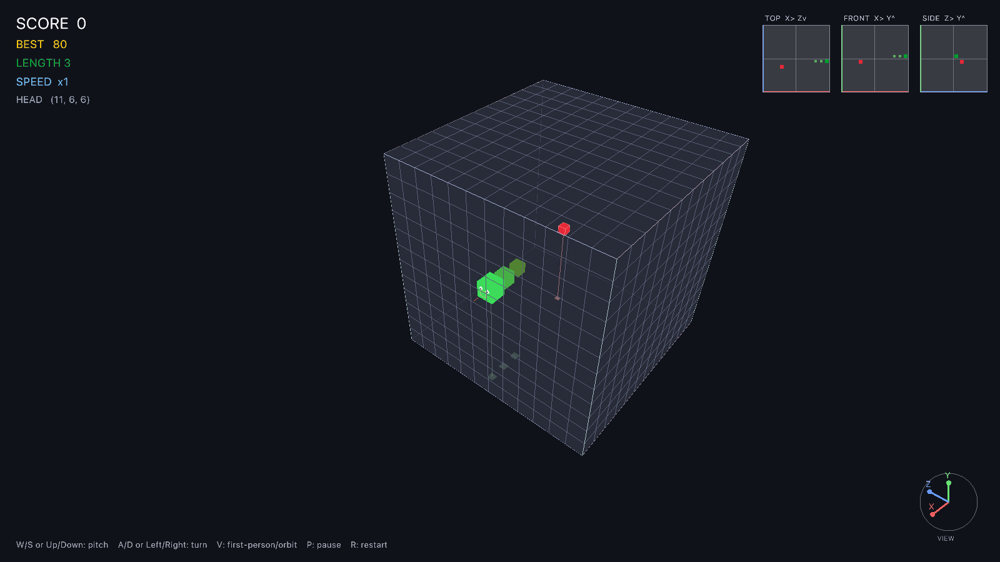

# 3D Snake (Odin + raylib)

A single-player, true-3D snake game written in **Odin** with **raylib**.
The snake flies through a 12×12×12 cubic lattice in **six directions** —
no gravity, no floor, pure 3D piloting.



## Features

- **True 3D movement** — six directions (±X, ±Y, ±Z) inside a 12³ cube
- **Panoramic orbit camera** by default (right-drag to orbit, wheel to zoom),
  with an optional **first-person view** (press `V`)
- **Flight-path guide** — a dotted line ahead of the snake shows where flying
  straight leads, colored green → yellow → red by distance to the obstacle
- **Navigation aids** — tri-view minimap (top / front / side projections),
  a camera-linked axis compass, and cube edges color-coded by axis
  (X = red, Y = green, Z = blue)
- Plane-like relative steering: the snake waits for your first input
- Smooth interpolated movement and 90° turn animations, particles,
  procedurally synthesized sound effects (no asset files), pause/restart,
  persistent best score

## Controls

| Input | Action |
|---|---|
| `A` / `D` or `←` / `→` | Turn left / right |
| `W` / `S` or `↑` / `↓` | Pitch up / down |
| `V` | Toggle first-person / orbit camera |
| Right mouse drag | Orbit camera (orbit mode) |
| Mouse wheel | Zoom |
| `P` | Pause |
| `R` | Restart |
| `Space` / `Enter` | Start / play again |

## Download

Grab the prebuilt binary from
[Releases](../../releases) (`snake3d-macos-arm64.zip`, macOS Apple Silicon).
The binary is self-contained (raylib statically linked, system fonts only).

> First launch: macOS Gatekeeper may block an unsigned download —
> right-click the app and choose **Open**, or run
> `xattr -d com.apple.quarantine snake3d`.

## Build from source

Requires the [Odin compiler](https://odin-lang.org/) (ships with `vendor:raylib`):

```bash
odin build . -out:snake3d -o:speed
./snake3d
```

Single file: `main.odin`, no other dependencies.
