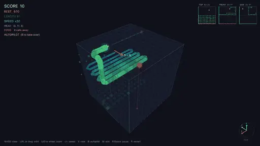
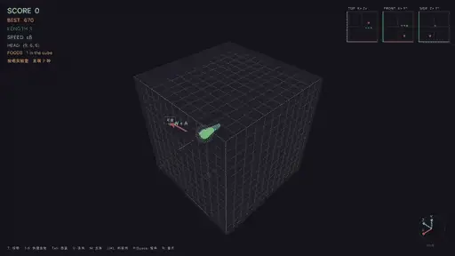
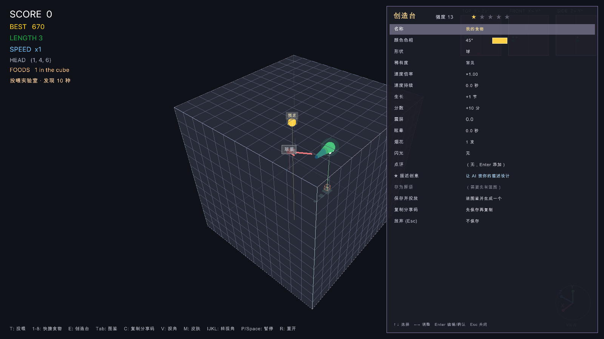
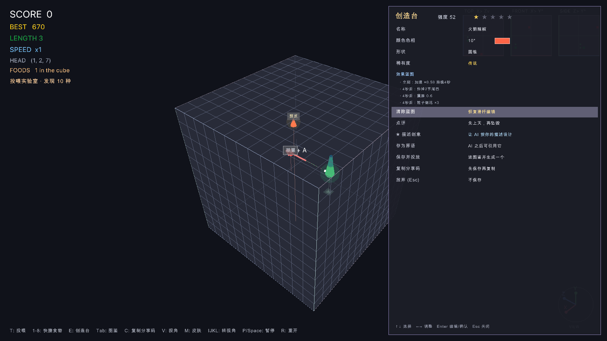
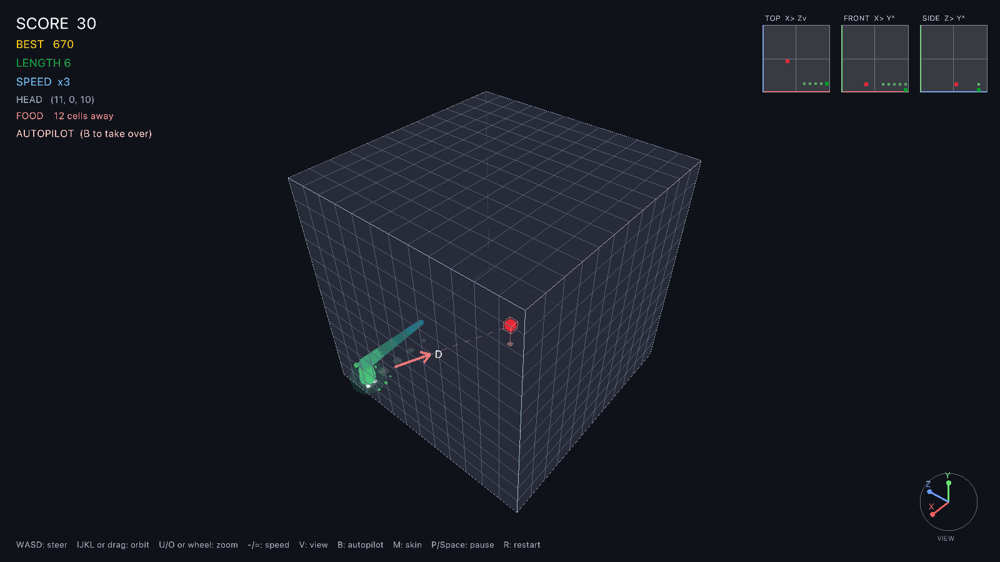
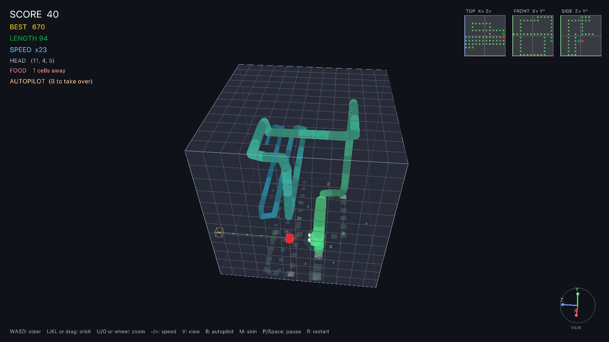
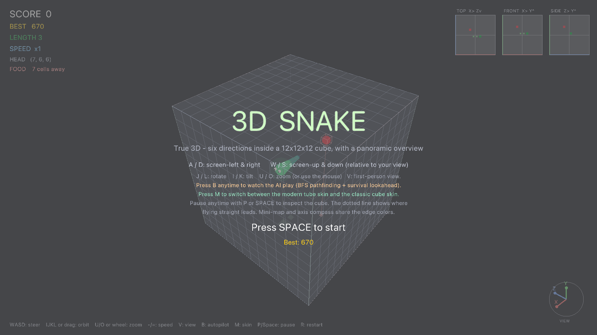

# 3D Snake (Odin + raylib)

> Language: [简体中文](README.md) | **English**

A single-player, true-3D snake game written in **Odin** with **raylib**.
The snake flies through a 12×12×12 cubic lattice in **six directions** —
no gravity, no floor, pure 3D piloting.



*The built-in AI (press `B`) piloting a 90+ segment snake — BFS pathfinding
with survival lookahead, shown in the modern tube skin.*

## Feeding Lab

Press `F` on the title screen: the roles flip — **the AI flies the snake, you
invent the food**. Type any word (`T`) and the game deterministically
generates a food from it: color, shape, spin, rarity, and 1–3 effects
(speed burst, freeze, growth, body chop, score bonus/penalty, dizziness,
explosion…). The AI places it in the cube and hunts it down.



*A scripted tasting menu: apple + star → chili speed rage → grenade blows
the tail off → poop & poison mushroom (the snake will remember these).*

- **8 preset foods** on keys `1`–`8`: apple, chili (speed rage), popsicle
  (slow-mo), grenade (blows off tail segments), poop (score penalty),
  poison mushroom (dizziness), star (legendary bonus), mystery egg
  (random effects every time)
- **Free-form foods** — every word becomes a unique, repeatable recipe;
  rare and legendary rolls get extra effects and a glowing aura
- **The snake learns** — foods are judged by net value
  (growth×2 + score/10 − dizziness×1.5), so a mostly-great food with a
  nasty side effect won't be refused. Hurt it twice with the same food
  name and it refuses that food forever (the food rots away) — a toast
  tells you when immunity kicks in. Keep inventing!
- **Food dex** (`Tab`) — every kind you've discovered, with its effect tags

### AI recipes (optional)

When you cast a brand-new word, the game can first ask a large language
model to "cook" a recipe for it on the spot: color, shape, rarity, a witty
one-line review, and effects (speed/chop/confusion…) that match the food's
real-world character. Configuration (any OpenAI-compatible endpoint works
— Kimi, OpenAI, a local Ollama, …):

```bash
export FEED_LLM_API_KEY=sk-...                     # unset = fully offline, local generation
export FEED_LLM_BASE_URL=https://api.moonshot.cn/v1  # default; any compatible endpoint
export FEED_LLM_MODEL=kimi-k2-0905-preview           # default
```

- **Playable offline** — without a key everything works as before
  (deterministic local hash recipes); failed requests, timeouts (12 s),
  or unparseable AI output also fall back to the local recipe
- **Never blocks the game** — the request goes out via `curl` on a worker
  thread while the game loop keeps running; the HUD shows
  `AI cooking: <word>` and the recipe upgrades the placeholder in place
- **One word at a time** — new words cast while cooking use local recipes
- Every kind's origin is tagged in the dex: `preset` / `local` / `AI` /
  `shared`

### Share codes

Every food can become a portable share code (starts with `SNAKE3D1.`,
base64url-encoded JSON recipe):

- After casting, press `C` — copy the most recently cast food's code
- In the dex (`Tab`), select with `↑` / `↓` and press `C` to copy that row
- In the feed box (`T`), `Cmd+V` paste someone's `SNAKE3D1.…` code and hit
  Enter — decoded, validated, clamped, and cast as a new food (name
  clashes get an automatic `~2` suffix)

### Creator Workshop (press `E`)

In Feeding Lab, press `E` to open the workshop: a design panel on the
right plus a live preview sample in the cube, while the game keeps
running. `↑` `↓` move between fields, `←` `→` adjust values (hold to
auto-repeat), `Enter` edits text or triggers buttons, `Esc` closes.

- **Manual sliders** — name, hue, shape, rarity, plus speed
  multiplier/duration, growth, score, screen shake, confusion, fireworks,
  flash; a purely-for-fun "power score" with 1–5 stars sits on top
- **★ Describe an idea** — describe the effect you want in natural
  language ("rocket chili", "a hen that lays eggs") and the AI drafts the
  whole package: name, color, rarity, a one-line review, and an
  orchestratable **effect blueprint**. Uses the same `FEED_LLM_*`
  variables as AI recipes; without a key you can only design manually
- **Effect blueprints** — 11 primitive nodes: speed, growth, score,
  shake, confusion, flash, fireworks, plus **egg-laying** (spawns new
  foods on the board), **shield** (invincible to walls and self-bite),
  **reverse** (head-tail swap), and **score multiplier**; compose them
  with delay / repeat / chance for dramatic timing. While a blueprint is
  attached the sliders hide, and the dex shows a `[blueprint]` tag
- **Save as primitive** — name and save the current blueprint as your own
  "primitive" (persisted to `macros.json`). Future AI designs can
  reference your primitives; share codes bundle the referenced macros,
  and importing auto-registers them (never overwriting same-named local
  ones)
- **Creator nickname** — asked once on your first save and written to
  `creator.txt` (the `SNAKE_CREATOR` env var takes precedence); every
  share code you export carries this byline
- **Local library** — every "save & cast" stores the creation in
  `creations.json` (up to 64), reloaded into the dex on next launch; in
  the dex, press `X` on a creation to delete it from the library (foods
  already on the board are unaffected), or `Enter` to cast another one
- **⇧1-8 quick cast** — re-cast without opening the dex: `⇧1` is your
  most recent creation, `⇧2` the one before, and so on; the HUD lists the
  current key-to-food mapping at the bottom
- In the dex (`Tab`), press `E` on any row to **remix** that food

| Manual design | AI creative blueprint |
| :---: | :---: |
|  |  |

## Features

- **True 3D movement** — six directions (±X, ±Y, ±Z) inside a 12³ cube
- **AI autopilot** (`B`) — watch the AI play: BFS shortest path to the food,
  plus a survival simulation that only commits to a meal when the head can
  still reach its own tail afterwards; falls back to tail-chasing to stay
  alive and auto-restarts after death. Take back control anytime with `B`
- **Two snake skins** (`M`) — a glossy modern tube body (tapered capsules,
  emerald→ocean gradient, specular glints, head aura, distance fog) or the
  classic cube look
- **Panoramic orbit camera** by default: the whole cube rotates around its
  center as one rigid object (keyboard `IJKL` or mouse drag), with an
  optional **first-person view** (press `V`)
- **Screen-relative steering** — in orbit view `A/D/W/S` always mean
  screen-left/right/up/down, no matter how the cube is rotated
- **Flight-path guide** — a dotted line ahead of the snake shows where flying
  straight leads, colored green → yellow → red by distance to the obstacle
- **Navigation aids** — tri-view minimap (top / front / side projections),
  a camera-linked axis compass, an on-screen guidance arrow with key hints,
  a dashed head→food tether line, and a live "cells away" readout
- **Speed control** — `-` slows down, `=` speeds up; eating also accelerates
- Pause anytime and keep orbiting the frozen cube to plan your route
- Smooth interpolated movement and 90° turn animations, particles,
  procedurally synthesized sound effects (no asset files),
  persistent best score

## Screenshots

| Modern tube skin | AI autopilot, 94 segments |
|---|---|
|  |  |



## Controls

| Input | Action |
|---|---|
| `A` / `D` or `←` / `→` | Steer screen-left / screen-right |
| `W` / `S` or `↑` / `↓` | Steer screen-up / screen-down |
| `B` | Toggle AI autopilot |
| `M` | Toggle modern / classic skin |
| `J` / `L` | Rotate the cube |
| `I` / `K` | Tilt the cube |
| `U` / `O` or mouse wheel | Zoom in / out |
| Mouse drag (left or right) | Orbit (alternative) |
| `V` | Toggle first-person / orbit camera |
| `-` / `=` | Slow down / speed up |
| `P` or `Space` | Pause / resume |
| `R` | Restart |
| `Space` / `Enter` | Start / play again |

### Feeding Lab only

| Input | Action |
|---|---|
| `T` | Open the feed box — type any word, Enter to cast it |
| `1` – `8` | Cast a preset food instantly |
| `⇧1` – `⇧8` | Quick-cast creations from your library (newest first) |
| `E` | Open the Creator Workshop; with the dex open, remix the selected kind |
| `Tab` | Toggle the food dex (discovered kinds & effects) |
| `↑` / `↓` (in dex) | Select a row |
| `Enter` (in dex) | Cast the selected food (dex stays open) |
| `X` (in dex) | Delete the selected creation from the library |
| `C` | Copy the share code (last cast, or the selected dex row) |
| `Cmd+V` (in feed box) | Paste a `SNAKE3D1.` share code to import |

### Creator Workshop only

| Input | Action |
|---|---|
| `↑` / `↓` | Move the field cursor |
| `←` / `→` | Adjust the value (hold to auto-repeat) |
| `Enter` | Edit text / trigger the button |
| `Esc` | Cancel the current input, then close the workshop |

## Download

Grab the prebuilt binary from
[Releases](../../releases) (`snake3d-macos-arm64.zip`, macOS Apple Silicon).
The binary is self-contained (raylib statically linked, system fonts only).

> First launch: macOS Gatekeeper may block an unsigned download —
> right-click the app and choose **Open**, or run
> `xattr -d com.apple.quarantine snake3d`.

## Build from source

Requires the [Odin compiler](https://odin-lang.org/) (ships with `vendor:raylib`):

```bash
odin build . -out:snake3d -o:speed
./snake3d
```

Single file: `main.odin`, no other dependencies.
